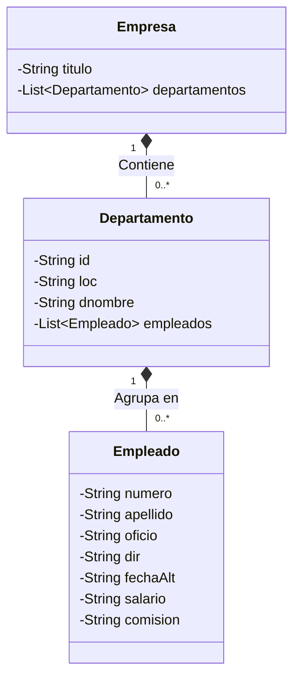

# 🎙️ Guion Definitivo del Proyecto: DOM y JAXB en Java

> **¿Cómo usar este documento?**  
> Este documento está redactado como un **guion conversacional y pedagógico**, pensado tanto para que comprendas el proyecto a fondo como para que puedas **defenderlo o explicarlo en una exposición o examen oral** con total naturalidad y soltura.  
> Cada archivo `.java` está desglosado **línea por línea o bloque por bloque**, explicando **qué hace cada instrucción** y, lo más importante, **por qué se hizo exactamente de esa manera y qué pasaría si no estuviera**.

---

## 🧭 Acto 0: La Película Completa (Para entender el proyecto en 2 minutos)

Imagina este escenario:
1. Una empresa nos entrega un archivo llamado `DepartamentosEmpleados.xml`.
2. Ese archivo está organizado como si fuera una base de datos antigua ("plana"): por un lado están todos los departamentos sueltos (`<DEP_ROW>`) y por otro lado todos los empleados sueltos (`<EMP_ROW>`). Los empleados tienen un campo llamado `<DEPT_NO>` que dice a qué departamento pertenecen, pero **no están metidos dentro del departamento**.
3. Nos piden dos ejercicios:
   - **Ejercicio 1 (`Ejercicio1DOM.java`)**: Leer ese archivo mediante **DOM**, cruzar en memoria los datos (hacer una especie de *JOIN* de SQL) y mostrar por pantalla cada departamento con sus respectivos trabajadores debajo.
   - **Ejercicio 2 (`Ejercicio2JAXB.java`)**: Leer los mismos datos con **DOM**, meterlos en objetos Java estructurados (`Empresa`, `Departamento`, `Empleado`) y usar **JAXB** para exportar un nuevo archivo llamado `DatosEmpresa.xml` donde los empleados **sí estén jerárquicamente dentro de su departamento**.

### 🧩 Mapa de Clases del Proyecto



---

## 1. 📄 `Empleado.java` (El modelo de cada trabajador)

Este archivo es un **POJO** (*Plain Old Java Object*), es decir, una clase de toda la vida con atributos privados, constructores y getters/setters, pero con **anotaciones de JAXB** que le dicen a Java cómo transformar este objeto en una etiqueta `<EMPLEADO>`.

### 🔍 Código de referencia

```java
1: import javax.xml.bind.annotation.XmlAccessType;
2: import javax.xml.bind.annotation.XmlAccessorType;
3: import javax.xml.bind.annotation.XmlAttribute;
4: import javax.xml.bind.annotation.XmlElement;
5: import javax.xml.bind.annotation.XmlType;
6: 
7: // Clase que representa la etiqueta <EMPLEADO>
8: @XmlAccessorType(XmlAccessType.FIELD)
9: @XmlType(propOrder = { "apellido", "oficio", "dir", "fechaAlt", "salario", "comision" })
10: public class Empleado {
11: 
12:     // El número de empleado va como atributo 'numero'
13:     @XmlAttribute(name = "numero")
14:     private String numero;
15: 
16:     @XmlElement(name = "APELLIDO")
17:     private String apellido;
18: 
19:     @XmlElement(name = "OFICIO")
20:     private String oficio;
21: 
22:     @XmlElement(name = "DIR")
23:     private String dir;
24: 
25:     @XmlElement(name = "FECHA_ALT")
26:     private String fechaAlt;
27: 
28:     @XmlElement(name = "SALARIO")
29:     private String salario;
30: 
31:     @XmlElement(name = "COMISION")
32:     private String comision;
33: 
34:     // Constructor vacío que necesita JAXB
35:     public Empleado() {
36:     }
37: 
38:     // Constructor con datos para rellenarlo fácil
39:     public Empleado(String numero, String apellido, String oficio, String dir, String fechaAlt, String salario, String comision) {
40:         this.numero = numero;
41:         this.apellido = apellido;
42:         this.oficio = oficio;
43:         this.dir = dir;
44:         this.fechaAlt = fechaAlt;
45:         this.salario = salario;
46:         this.comision = comision;
47:     }
48: 
49:     // Getters y Setters
50:     public String getNumero() { return numero; }
51:     public void setNumero(String numero) { this.numero = numero; }
52:     // ... getters y setters del resto de campos ...
105: }
```

### 🗣️ Explicación línea por línea y justificación técnica

#### Líneas 1 a 5: `import javax.xml.bind.annotation...`
- **¿Qué hace?** Importa las herramientas de JAXB para anotar clases (`XmlAccessorType`, `XmlAttribute`, `XmlElement`, etc.).
- **¿Por qué se hace así?** En Java moderno (a partir de Java 9/11 y en nuestro caso JDK 25), JAXB ya no viene incluido en el núcleo de la máquina virtual. Por eso importamos el paquete estándar `javax.xml.bind.*` que proviene de los `.jar` que tenemos en la carpeta `lib/` (`jaxb-api.jar`, `jaxb-runtime.jar`, etc.).

#### Línea 8: `@XmlAccessorType(XmlAccessType.FIELD)`
- **¿Qué hace?** Le ordena a JAXB: *"Mira directamente las variables privadas (`fields`) para saber qué guardar en el XML, e ignora los métodos getters y setters"*.
- **¿Por qué se hace así?** Si no pones esta línea, JAXB por defecto mira los métodos `get` y `set`. Si luego anotas una variable privada, JAXB intentará procesar la variable **y** el getter, lanzando un error fatal de colisión de propiedades (*"Class has two properties of the same name"*). Usar `FIELD` es la mejor práctica: limpias el código y colocas las anotaciones directamente sobre los atributos.

#### Línea 9: `@XmlType(propOrder = { "apellido", "oficio", "dir", "fechaAlt", "salario", "comision" })`
- **¿Qué hace?** Fija el orden milimétrico en el que se van a escribir las etiquetas dentro de `<EMPLEADO>`.
- **¿Por qué se hace así?** Por defecto, la reflexión de Java no garantiza el orden de las variables. El enunciado de la práctica exige un esquema exacto: primero `<APELLIDO>`, luego `<OFICIO>`, `<DIR>`, `<FECHA_ALT>`, `<SALARIO>` y finalmente `<COMISION>`. Con `propOrder` garantizamos que el XML generado cumpla al 100% con la estructura pedida.

#### Líneas 13-14: `@XmlAttribute(name = "numero") private String numero;`
- **¿Qué hace?** Le indica a JAXB que `numero` **no** debe ser una etiqueta hija `<numero>`, sino un atributo de la propia etiqueta: `<EMPLEADO numero="7369">`.
- **¿Por qué se hace así?** El enunciado pide explícitamente `<EMPLEADO numero="XX">`. En la sintaxis XML, los atributos van dentro de la etiqueta que abre el elemento.

#### Líneas 16 a 32: `@XmlElement(name = "...")` y las variables
- **¿Qué hace?** Asocia cada variable Java con el nombre exacto de la etiqueta XML (`<APELLIDO>`, `<OFICIO>`, `<DIR>`, `<FECHA_ALT>`, `<SALARIO>`, `<COMISION>`).
- **¿Por qué se hace así?**
  1. En Java se usa la convención *camelCase* (`fechaAlt`), mientras que el XML requiere mayúsculas y guiones bajos (`FECHA_ALT`). Con `@XmlElement(name = "...")` hacemos esa traducción limpia sin romper las buenas prácticas de nomenclatura en Java.
  2. **¿Por qué son todos `String` y no `double` o `int`?** Porque en esta práctica no tenemos que sumar salarios ni calcular medias numéricas; sólo leemos texto y lo volvemos a escribir. Usar `String` es mucho más seguro porque evita excepciones de formato numérico si en el XML viene un campo vacío o con caracteres raros.

#### Líneas 35-36: Constructor vacío `public Empleado() {}`
- **¿Qué hace?** Declara un constructor sin argumentos que no hace nada.
- **¿Por qué se hace así? (Pregunta estrella de examen):**  
  JAXB necesita **obligatoriamente** un constructor vacío. JAXB crea los objetos por reflexión en memoria y luego les inyecta los valores. En Java, si tú escribes un constructor con parámetros, Java automáticamente **borra** el constructor vacío por defecto. Por eso hay que volver a escribirlo a mano. Si lo quitas, el programa falla.

#### Líneas 39-47: Constructor parametrizado `public Empleado(String numero, ...)`
- **¿Qué hace?** Permite crear un objeto `Empleado` asignándole todos sus datos en una sola línea de código.
- **¿Por qué se hace así?** Para ahorrar código en `Ejercicio2JAXB.java`. En lugar de hacer `new Empleado()` y luego 7 líneas de `set...()`, creamos el empleado entero de un solo golpe.

#### Líneas 50 a 104: Métodos `get` y `set`
- **¿Qué hace?** Permiten consultar y modificar de forma controlada las variables privadas.
- **¿Por qué se hace así?** Cumple con el principio de encapsulamiento de la Programación Orientada a Objetos.

---

## 2. 🏢 `Departamento.java` (El contenedor departamental)

Representa cada departamento (`<DEPARTAMENTO>`) y tiene la particularidad de albergar dentro una colección de empleados (`List<Empleado>`).

### 🔍 Código de referencia

```java
1: import java.util.ArrayList;
2: import java.util.List;
3: import javax.xml.bind.annotation.XmlAccessType;
4: import javax.xml.bind.annotation.XmlAccessorType;
5: import javax.xml.bind.annotation.XmlAttribute;
6: import javax.xml.bind.annotation.XmlElement;
7: import javax.xml.bind.annotation.XmlElementWrapper;
8: import javax.xml.bind.annotation.XmlType;
9: 
10: // Clase que representa la etiqueta <DEPARTAMENTO>
11: @XmlAccessorType(XmlAccessType.FIELD)
12: @XmlType(propOrder = { "loc", "dnombre", "empleados" })
13: public class Departamento {
14: 
15:     // El número de departamento va en el atributo 'id'
16:     @XmlAttribute(name = "id")
17:     private String id;
18: 
19:     @XmlElement(name = "LOC")
20:     private String loc;
21: 
22:     @XmlElement(name = "DNOMBRE")
23:     private String dnombre;
24: 
25:     // Etiqueta contenedora <EMPLEADOS> con la lista de <EMPLEADO>
26:     @XmlElementWrapper(name = "EMPLEADOS")
27:     @XmlElement(name = "EMPLEADO")
28:     private List<Empleado> empleados = new ArrayList<>();
29: 
30:     // Constructor vacío necesario para JAXB
31:     public Departamento() {
32:     }
33: 
34:     // Constructor con los datos básicos
35:     public Departamento(String id, String dnombre, String loc) {
36:         this.id = id;
37:         this.dnombre = dnombre;
38:         this.loc = loc;
39:     }
40: 
41:     // Getters y Setters
42:     public String getId() { return id; }
43:     public void setId(String id) { this.id = id; }
44:     // ... resto de getters y setters ...
73: }
```

### 🗣️ Explicación línea por línea y justificación técnica

#### Líneas 1 y 2: Imports de `ArrayList` y `List`
- **¿Qué hace?** Importa la interfaz `List` y su implementación `ArrayList` de la biblioteca estándar de Java para almacenar colecciones de elementos.

#### Líneas 11 y 12: `@XmlAccessorType(XmlAccessType.FIELD)` y `@XmlType(propOrder = ...)`
- **¿Qué hace?** Igual que en `Empleado`: le dice a JAXB que lea las variables privadas directamente y que el orden de salida sea: primero `<LOC>`, segundo `<DNOMBRE>` y tercero `<EMPLEADOS>`.
- **¿Por qué se hace así?** El enunciado especifica en el ejemplo que `<LOC>` va antes que `<DNOMBRE>`. Si no fijamos el `propOrder`, podrían salir al revés.

#### Líneas 16-17: `@XmlAttribute(name = "id") private String id;`
- **¿Qué hace?** Convierte la variable `id` (que guarda el número del departamento) en un atributo de la etiqueta: `<DEPARTAMENTO id="10">`.
- **¿Por qué se hace así?** El esquema del enunciado no tiene una etiqueta `<ID>10</ID>`, sino que exige expresamente el atributo `id="..."`.

#### Líneas 19 a 23: `@XmlElement(name = "LOC")` y `@XmlElement(name = "DNOMBRE")`
- **¿Qué hace?** Mapea la localidad y el nombre del departamento a etiquetas hijas simples.

#### Líneas 26 a 28: La combinación clave `@XmlElementWrapper` + `@XmlElement`
```java
@XmlElementWrapper(name = "EMPLEADOS")
@XmlElement(name = "EMPLEADO")
private List<Empleado> empleados = new ArrayList<>();
```
- **¿Qué hace?**
  - `@XmlElementWrapper(name = "EMPLEADOS")`: Genera una etiqueta envoltorio exterior llamada `<EMPLEADOS>`.
  - `@XmlElement(name = "EMPLEADO")`: Define el nombre de cada elemento individual que va metido dentro de esa envoltura.
  - `private List<Empleado> empleados = new ArrayList<>();`: Declara e inicializa la lista vacía de empleados.
- **¿Por qué se hace así? (Punto crítico de comprensión JAXB):**  
  Si sólo pusieras `@XmlElement(name = "EMPLEADO")` sin el wrapper, JAXB generaría esto:
  ```xml
  <!-- SIN WRAPPER (INCORRECTO SEGÚN ENUNCIADO) -->
  <DEPARTAMENTO id="10">
      <LOC>SEVILLA</LOC>
      <DNOMBRE>CONTABILIDAD</DNOMBRE>
      <EMPLEADO numero="7782">...</EMPLEADO>
      <EMPLEADO numero="7839">...</EMPLEADO>
  </DEPARTAMENTO>
  ```
  Pero con `@XmlElementWrapper(name = "EMPLEADOS")`, logramos la estructura exacta exigida:
  ```xml
  <!-- CON WRAPPER (CORRECTO) -->
  <DEPARTAMENTO id="10">
      <LOC>SEVILLA</LOC>
      <DNOMBRE>CONTABILIDAD</DNOMBRE>
      <EMPLEADOS>
          <EMPLEADO numero="7782">...</EMPLEADO>
          <EMPLEADO numero="7839">...</EMPLEADO>
      </EMPLEADOS>
  </DEPARTAMENTO>
  ```
- **¿Por qué se inicializa `= new ArrayList<>()` directamente en la declaración?**  
  Para evitar a toda costa el temido `NullPointerException`. Si no lo inicializamos, la lista valdría `null`, y al intentar hacer `depto.getEmpleados().add(emp)` el programa petaría. Al tenerlo ya creado, la lista siempre está lista para recibir empleados.

#### Líneas 31 a 39: Constructores
- `public Departamento() {}`: Constructor sin argumentos exigido por JAXB.
- `public Departamento(String id, String dnombre, String loc)`: Constructor para rellenar los datos del departamento rápidamente al leerlos desde el DOM.

---

## 3. 👑 `Empresa.java` (La raíz del documento)

Esta clase es la **cabeza** de todo el árbol XML. Es el objeto que le entregaremos a JAXB para que empiece a escribir.

### 🔍 Código de referencia

```java
1: import java.util.ArrayList;
2: import java.util.List;
3: import javax.xml.bind.annotation.XmlAccessType;
4: import javax.xml.bind.annotation.XmlAccessorType;
5: import javax.xml.bind.annotation.XmlElement;
6: import javax.xml.bind.annotation.XmlRootElement;
7: import javax.xml.bind.annotation.XmlType;
8: 
9: // Elemento raíz <EMPRESA>
10: @XmlRootElement(name = "EMPRESA")
11: @XmlAccessorType(XmlAccessType.FIELD)
12: @XmlType(propOrder = { "titulo", "departamentos" })
13: public class Empresa {
14: 
15:     // Título que encabeza el XML de salida
16:     @XmlElement(name = "TITULO")
17:     private String titulo = "DATOS DE LAS TABLA DEPART y EMPLE ";
18: 
19:     // Lista de etiquetas <DEPARTAMENTO>
20:     @XmlElement(name = "DEPARTAMENTO")
21:     private List<Departamento> departamentos = new ArrayList<>();
22: 
23:     // Constructor vacío necesario para JAXB
24:     public Empresa() {
25:     }
26: 
27:     // Constructor opcional por si queremos cambiar el título
28:     public Empresa(String titulo) {
29:         this.titulo = titulo;
30:     }
31: 
32:     // Getters y Setters
33:     public String getTitulo() { return titulo; }
34:     public void setTitulo(String titulo) { this.titulo = titulo; }
35:     public List<Departamento> getDepartamentos() { return departamentos; }
36:     public void setDepartamentos(List<Departamento> departamentos) { this.departamentos = departamentos; }
37: }
```

### 🗣️ Explicación línea por línea y justificación técnica

#### Línea 10: `@XmlRootElement(name = "EMPRESA")`
- **¿Qué hace?** Marca a esta clase como la **etiqueta raíz** del documento XML (`<EMPRESA>...</EMPRESA>`).
- **¿Por qué se hace así?** Todo documento XML válido en el mundo debe tener una y sólo una etiqueta raíz que envuelva a todas las demás. JAXB necesita saber qué clase es la raíz para saber por dónde empezar a escribir el archivo. Si olvidas `@XmlRootElement`, el `Marshaller` lanzará una excepción diciendo que no sabe cómo serializar la clase.

#### Línea 12: `@XmlType(propOrder = { "titulo", "departamentos" })`
- **¿Qué hace?** Garantiza que la etiqueta `<TITULO>` se escriba siempre antes que los bloques de `<DEPARTAMENTO>`.

#### Líneas 16-17: `@XmlElement(name = "TITULO") private String titulo = "...";`
- **¿Qué hace?** Crea el elemento `<TITULO>` con el texto literal `"DATOS DE LAS TABLA DEPART y EMPLE "`.
- **¿Por qué se hace así?** El enunciado incluye ese texto exacto en su plantilla. Al inicializarlo por defecto en la propia variable, no tenemos que acordarnos de asignarlo en el `main`; el objeto ya nace con el título puesto.

#### Líneas 20-21: `@XmlElement(name = "DEPARTAMENTO") private List<Departamento> departamentos = ...;`
- **¿Qué hace?** Indica que cada elemento de la lista `departamentos` se escribirá como una etiqueta `<DEPARTAMENTO>`.
- **¿Por qué aquí NO se usa `@XmlElementWrapper`? (Pregunta de nota):**  
  Fíjate en el enunciado:  
  `<EMPRESA>`  
  `  <TITULO>...</TITULO>`  
  `  <DEPARTAMENTO id="10">...</DEPARTAMENTO>`  
  `  <DEPARTAMENTO id="20">...</DEPARTAMENTO>`  
  `</EMPRESA>`  
  No existe ninguna etiqueta `<DEPARTAMENTOS>` envolviendo la lista; los departamentos cuelgan directamente de `<EMPRESA>`. Por tanto, **no** debemos usar wrapper aquí.

---

## 4. 🔎 `Ejercicio1DOM.java` (Lectura y cruce con DOM)

Este programa es autónomo: tiene su propio método `main`, lee el archivo origen `DepartamentosEmpleados.xml` usando el analizador **DOM**, cruza en memoria los departamentos con sus empleados y muestra el resultado en la consola.

### 🔍 Código de referencia

```java
1: import java.io.File;
2: import javax.xml.parsers.DocumentBuilder;
3: import javax.xml.parsers.DocumentBuilderFactory;
4: import org.w3c.dom.Document;
5: import org.w3c.dom.Element;
6: import org.w3c.dom.NodeList;
7: 
8: public class Ejercicio1DOM {
9: 
10:     public static void main(String[] args) {
11:         try {
12:             // Buscamos el fichero XML usando ruta relativa
13:             File fichero = obtenerFicheroXml("DepartamentosEmpleados.xml");
14:             if (!fichero.exists()) {
15:                 System.out.println("No se ha encontrado el fichero: " + fichero.getPath());
16:                 return;
17:             }
18: 
19:             // Creamos el analizador DOM y cargamos el documento
20:             DocumentBuilderFactory factory = DocumentBuilderFactory.newInstance();
21:             DocumentBuilder builder = factory.newDocumentBuilder();
22:             Document doc = builder.parse(fichero);
23:             doc.getDocumentElement().normalize();
24: 
25:             // Obtenemos todos los departamentos y empleados del fichero
26:             NodeList listaDepartamentos = doc.getElementsByTagName("DEP_ROW");
27:             NodeList listaEmpleados = doc.getElementsByTagName("EMP_ROW");
28: 
29:             System.out.println("LISTADO DE DEPARTAMENTOS Y EMPLEADOS CON DOM");
30: 
31:             // Recorremos cada departamento
32:             for (int i = 0; i < listaDepartamentos.getLength(); i++) {
33:                 Element dep = (Element) listaDepartamentos.item(i);
34: 
35:                 String numDept = obtenerTexto(dep, "DEPT_NO");
36:                 String nombreDept = obtenerTexto(dep, "DNOMBRE");
37:                 String localidad = obtenerTexto(dep, "LOC");
38: 
39:                 System.out.println("DEPARTAMENTO " + numDept + ": " + nombreDept + " (" + localidad + ")");
40: 
41:                 // Buscamos los empleados que pertenecen a este departamento
42:                 boolean tieneEmpleados = false;
43:                 for (int j = 0; j < listaEmpleados.getLength(); j++) {
44:                     Element emp = (Element) listaEmpleados.item(j);
45:                     String deptEmpleado = obtenerTexto(emp, "DEPT_NO");
46: 
47:                     if (numDept.equals(deptEmpleado)) {
48:                         tieneEmpleados = true;
49:                         String apellido = obtenerTexto(emp, "APELLIDO");
50:                         String oficio = obtenerTexto(emp, "OFICIO");
51:                         String salario = obtenerTexto(emp, "SALARIO");
52:                         String comision = obtenerTexto(emp, "COMISION");
53: 
54:                         System.out.println("  * " + apellido + " | " + oficio +
55:                                            " | Salario: " + salario + " €" +
56:                                            " | Comisión: " + comision + " €");
57:                     }
58:                 }
59: 
60:                 // Si un departamento no tiene empleados (como Producción)
61:                 if (!tieneEmpleados) {
62:                     System.out.println("  (Este departamento no tiene empleados)");
63:                 }
64:             }
65: 
66:             System.out.println("Proceso finalizado correctamente.");
67: 
68:         } catch (Exception e) {
69:             System.out.println("Error al procesar el XML con DOM: " + e.getMessage());
70:             e.printStackTrace();
71:         }
72:     }
73: 
74:     // Método auxiliar para leer el texto de una etiqueta dentro de un elemento
75:     private static String obtenerTexto(Element elemento, String etiqueta) {
76:         NodeList lista = elemento.getElementsByTagName(etiqueta);
77:         if (lista != null && lista.getLength() > 0) {
78:             return lista.item(0).getTextContent().trim();
79:         }
80:         return "";
81:     }
82: 
83:     // Localiza el fichero tanto si se ejecuta desde la raíz como desde otra carpeta
84:     private static File obtenerFicheroXml(String nombreFichero) {
85:         File f = new File(nombreFichero);
86:         if (!f.exists()) {
87:             f = new File("../" + nombreFichero);
88:         }
89:         return f;
90:     }
91: }
```

### 🗣️ Explicación línea por línea y justificación técnica

#### Líneas 1 a 6: Imports de DOM (`org.w3c.dom.*`) y Parsers
- **¿Qué hace?** Importa las clases oficiales del W3C (`Document`, `Element`, `NodeList`) y las factorías de Java (`DocumentBuilderFactory`, `DocumentBuilder`).
- **¿Por qué se hace así?** DOM es una especificación estándar de la industria. Permite cargar el documento XML al completo en la memoria RAM en forma de un árbol jerárquico de nodos por el que podemos movernos con total libertad.

#### Línea 11: Bloque `try { ... } catch (Exception e) { ... }`
- **¿Qué hace?** Envuelve todo el proceso para capturar cualquier posible error.
- **¿Por qué se hace así?** Leer archivos de disco y parsear XML puede arrojar excepciones como `FileNotFoundException`, `SAXException` (si el XML está mal formado) o `ParserConfigurationException`. Al capturarlas, el programa avisa amablemente en lugar de quebrarse bruscamente.

#### Líneas 13 a 17: Localización segura del fichero
```java
File fichero = obtenerFicheroXml("DepartamentosEmpleados.xml");
if (!fichero.exists()) { ... return; }
```
- **¿Qué hace?** Busca el archivo `DepartamentosEmpleados.xml` y verifica si realmente existe en disco antes de seguir.
- **¿Por qué se hace así?** Una causa habitual de suspenso en estas prácticas es que el código funciona en el ordenador del alumno pero falla en el del profesor porque el profesor ejecuta el programa desde la carpeta raíz o desde la carpeta `bin`. El método `obtenerFicheroXml` comprueba la carpeta actual y la carpeta superior (`../`), garantizando que siempre lo encuentre sin usar rutas absolutas (prohibidas por el enunciado).

#### Líneas 20 a 23: Creación del parser DOM y carga del archivo
```java
DocumentBuilderFactory factory = DocumentBuilderFactory.newInstance();
DocumentBuilder builder = factory.newDocumentBuilder();
Document doc = builder.parse(fichero);
doc.getDocumentElement().normalize();
```
- **¿Qué hace cada una de estas 4 líneas?**
  1. `factory = DocumentBuilderFactory.newInstance()`: Crea una factoría siguiendo el patrón de diseño *Abstract Factory*.
  2. `builder = factory.newDocumentBuilder()`: La factoría fabrica el analizador (`builder`) configurado.
  3. `doc = builder.parse(fichero)`: Lee el fichero del disco, analiza la sintaxis XML y monta en la memoria RAM el árbol de nodos `Document`.
  4. `doc.getDocumentElement().normalize()`: **Normaliza** el documento.
- **¿Por qué se hace el `normalize()`? (Pregunta clásica de examen):**  
  En XML, cuando un analizador lee texto con saltos de línea o espacios, a veces divide una sola frase en varios nodos de texto consecutivos (`TextNode`). La llamada a `normalize()` limpia el árbol: fusiona nodos de texto adyacentes y elimina nodos vacíos inútiles, garantizando que `.getTextContent()` devuelva la cadena de texto íntegra sin sustos.

#### Líneas 26 y 27: Obtener los nodos por su etiqueta
```java
NodeList listaDepartamentos = doc.getElementsByTagName("DEP_ROW");
NodeList listaEmpleados = doc.getElementsByTagName("EMP_ROW");
```
- **¿Qué hace?** Rastrea todo el árbol XML y devuelve todas las etiquetas `<DEP_ROW>` en una lista y todas las `<EMP_ROW>` en otra.
- **¿Por qué se hace así?** Porque en el archivo original los departamentos y empleados están en bloques separados. Esta llamada nos da acceso directo a todos ellos sin tener que navegar nodo padre por nodo hijo manualmente.

#### Líneas 32 a 37: Recorrido de los departamentos
```java
for (int i = 0; i < listaDepartamentos.getLength(); i++) {
    Element dep = (Element) listaDepartamentos.item(i);
    String numDept = obtenerTexto(dep, "DEPT_NO");
    ...
```
- **¿Qué hace?** Itera sobre la lista de departamentos.
- **¿Por qué el cast `(Element)`?** Porque el método `item(i)` devuelve un `Node` genérico (que podría ser un comentario o un espacio). Hacemos el cast a `Element` para poder utilizar métodos específicos de elementos XML como `getElementsByTagName`.
- Extraemos `DEPT_NO`, `DNOMBRE` y `LOC` usando nuestro método seguro `obtenerTexto`.

#### Líneas 42 a 58: Cruce de datos (El "JOIN" en memoria)
```java
boolean tieneEmpleados = false;
for (int j = 0; j < listaEmpleados.getLength(); j++) {
    Element emp = (Element) listaEmpleados.item(j);
    String deptEmpleado = obtenerTexto(emp, "DEPT_NO");

    if (numDept.equals(deptEmpleado)) {
        tieneEmpleados = true;
        ...
```
- **¿Qué hace?** Por cada departamento, recorre la lista completa de empleados y compara: *"¿Es el número de departamento del empleado igual al número del departamento actual?"*. Si coincide, activa la bandera `tieneEmpleados = true` e imprime en pantalla el apellido, oficio, salario y comisión del empleado.
- **¿Por qué se hace así?** El XML original es relacional/plano. Como no están anidados en el origen, la única forma de mostrarlos agrupados es comparar sus claves ajenas (`DEPT_NO`).

#### Líneas 61 a 63: El control del departamento sin empleados
```java
if (!tieneEmpleados) {
    System.out.println("  (Este departamento no tiene empleados)");
}
```
- **¿Qué hace?** Si al terminar de revisar todos los empleados ninguno pertenecía a este departamento, imprime un mensaje explícito.
- **¿Por qué se hace así?** En el archivo de prueba, el departamento 40 (PRODUCCIÓN en BILBAO) no tiene trabajadores asignados. Si no pones este `if`, el departamento saldría en blanco y parecería un fallo del programa. Este detalle demuestra rigor y cuidado de los casos límite (*edge cases*).

#### Líneas 75 a 81: Método auxiliar `obtenerTexto(Element elemento, String etiqueta)`
```java
private static String obtenerTexto(Element elemento, String etiqueta) {
    NodeList lista = elemento.getElementsByTagName(etiqueta);
    if (lista != null && lista.getLength() > 0) {
        return lista.item(0).getTextContent().trim();
    }
    return "";
}
```
- **¿Qué hace?** Busca una etiqueta hija dentro del elemento padre, extrae su texto y le quita espacios sobrantes con `.trim()`. Si no existe, devuelve una cadena vacía `""`.
- **¿Por qué se hace así?** Si intentas hacer `elemento.getElementsByTagName("COMISION").item(0).getTextContent()` a pelo y la etiqueta no existe o viene vacía, Java lanza un `NullPointerException` fulminante. Este método encapsula esa comprobación y hace el código principal limpio, legible y a prueba de fallos.

#### Líneas 84 a 90: Método auxiliar `obtenerFicheroXml(String nombreFichero)`
- **¿Qué hace?** Si el fichero no existe en la ruta actual (`.`), lo busca en el directorio padre (`../`).
- **¿Por qué se hace así?** Asegura que el proyecto se pueda ejecutar indistintamente desde la línea de comandos, desde la raíz del proyecto o desde la carpeta `bin`/`src` de un IDE sin que salte el error de fichero no encontrado.

---

## 5. 🚀 `Ejercicio2JAXB.java` (Transformación con DOM + Marshalling con JAXB)

Este programa es la cúspide de la práctica: lee el XML plano con DOM, trasvasa toda la información a los objetos Java anotados (`Empresa`, `Departamento`, `Empleado`) y le pide a JAXB que haga el **Marshalling** para generar el archivo `DatosEmpresa.xml` con la jerarquía limpia.

### 🔍 Código de referencia

```java
1: import java.io.File;
2: import javax.xml.bind.JAXBContext;
3: import javax.xml.bind.Marshaller;
4: import javax.xml.parsers.DocumentBuilder;
5: import javax.xml.parsers.DocumentBuilderFactory;
6: import org.w3c.dom.Document;
7: import org.w3c.dom.Element;
8: import org.w3c.dom.NodeList;
9: 
10: public class Ejercicio2JAXB {
11: 
12:     public static void main(String[] args) {
13:         try {
14:             // 1. Buscamos el fichero origen con ruta relativa
15:             File ficheroEntrada = obtenerFicheroXml("DepartamentosEmpleados.xml");
16:             if (!ficheroEntrada.exists()) {
17:                 System.out.println("No se ha encontrado el fichero origen: " + ficheroEntrada.getPath());
18:                 return;
19:             }
20: 
21:             System.out.println("1. Leyendo datos con DOM desde: " + ficheroEntrada.getName());
22: 
23:             // Leemos el fichero XML mediante DOM
24:             DocumentBuilderFactory factory = DocumentBuilderFactory.newInstance();
25:             DocumentBuilder builder = factory.newDocumentBuilder();
26:             Document doc = builder.parse(ficheroEntrada);
27:             doc.getDocumentElement().normalize();
28: 
29:             // Creamos el objeto raíz para JAXB
30:             Empresa empresa = new Empresa();
31: 
32:             // Obtenemos las listas de departamentos y empleados del DOM
33:             NodeList listaDepartamentos = doc.getElementsByTagName("DEP_ROW");
34:             NodeList listaEmpleados = doc.getElementsByTagName("EMP_ROW");
35: 
36:             // Recorremos los departamentos
37:             for (int i = 0; i < listaDepartamentos.getLength(); i++) {
38:                 Element depElem = (Element) listaDepartamentos.item(i);
39: 
40:                 String idDept = obtenerTexto(depElem, "DEPT_NO");
41:                 String nombreDept = obtenerTexto(depElem, "DNOMBRE");
42:                 String localidad = obtenerTexto(depElem, "LOC");
43: 
44:                 // Creamos el objeto Departamento
45:                 Departamento depto = new Departamento(idDept, nombreDept, localidad);
46: 
47:                 // Buscamos los empleados que pertenecen a este departamento
48:                 for (int j = 0; j < listaEmpleados.getLength(); j++) {
49:                     Element empElem = (Element) listaEmpleados.item(j);
50:                     String deptEmpleado = obtenerTexto(empElem, "DEPT_NO");
51: 
52:                     if (idDept.equals(deptEmpleado)) {
53:                         String numEmp = obtenerTexto(empElem, "EMP_NO");
54:                         String apellido = obtenerTexto(empElem, "APELLIDO");
55:                         String oficio = obtenerTexto(empElem, "OFICIO");
56:                         String dir = obtenerTexto(empElem, "DIR");
57:                         String fechaAlt = obtenerTexto(empElem, "FECHA_ALT");
58:                         String salario = obtenerTexto(empElem, "SALARIO");
59:                         String comision = obtenerTexto(empElem, "COMISION");
60: 
61:                         Empleado emp = new Empleado(numEmp, apellido, oficio, dir, fechaAlt, salario, comision);
62:                         depto.getEmpleados().add(emp);
63:                     }
64:                 }
65: 
66:                 // Añadimos el departamento a la empresa
67:                 empresa.getDepartamentos().add(depto);
68:             }
69: 
70:             // 2. Definimos la ruta del fichero de salida DatosEmpresa.xml
71:             File ficheroSalida = new File(ficheroEntrada.getParent() != null ? ficheroEntrada.getParent() : ".", "DatosEmpresa.xml");
72:             System.out.println("2. Generando fichero XML con JAXB en: " + ficheroSalida.getPath());
73: 
74:             // Configuramos el contexto de JAXB con la clase Empresa
75:             JAXBContext context = JAXBContext.newInstance(Empresa.class);
76:             Marshaller marshaller = context.createMarshaller();
77: 
78:             // Opciones de formato para que el XML quede ordenado y legible
79:             marshaller.setProperty(Marshaller.JAXB_FORMATTED_OUTPUT, Boolean.TRUE);
80:             marshaller.setProperty(Marshaller.JAXB_ENCODING, "UTF-8");
81: 
82:             // Escribimos el XML en el fichero de salida
83:             marshaller.marshal(empresa, ficheroSalida);
84: 
85:             System.out.println("¡Listo! Se ha creado correctamente el fichero DatosEmpresa.xml.");
86: 
87:         } catch (Exception e) {
88:             System.out.println("Error durante la generación con JAXB: " + e.getMessage());
89:             e.printStackTrace();
90:         }
91:     }
92:     // ... métodos auxiliares obtenerTexto y obtenerFicheroXml ...
93: }
```

### 🗣️ Explicación línea por línea y justificación técnica

#### Líneas 2 a 3: Imports de JAXB (`JAXBContext` y `Marshaller`)
- **¿Qué hace?** Importa el contexto de JAXB (el motor) y el `Marshaller` (el componente que convierte objetos Java a XML).
- **¿Por qué se llama *Marshalling*?** En informática, *Marshalling* significa empaquetar o serializar una estructura de datos en memoria en un formato almacenable o transmitible (en este caso, un archivo XML de texto).

#### Línea 30: `Empresa empresa = new Empresa();`
- **¿Qué hace?** Crea el objeto raíz en memoria.
- **¿Por qué se hace así?** Este objeto actuará como contenedor maestro donde iremos guardando todos los departamentos y sus empleados.

#### Líneas 45: `Departamento depto = new Departamento(idDept, nombreDept, localidad);`
- **¿Qué hace?** Instancia un nuevo objeto `Departamento` con los datos leídos del DOM.

#### Líneas 61 y 62: Población de los empleados en el departamento
```java
Empleado emp = new Empleado(numEmp, apellido, oficio, dir, fechaAlt, salario, comision);
depto.getEmpleados().add(emp);
```
- **¿Qué hace?** Si el empleado pertenece al departamento actual, crea un objeto `Empleado` con todos sus datos y lo añade a la lista interna `empleados` de ese departamento.
- **¿Por qué se hace así?** Aquí es donde ocurre la auténtica **jerarquización**. En el XML de entrada el empleado estaba flotando en una lista separada; aquí lo estamos metiendo físicamente dentro de la lista de su departamento correspondiente.

#### Línea 67: `empresa.getDepartamentos().add(depto);`
- **¿Qué hace?** Añade el departamento (con todos sus empleados ya integrados dentro de él) a la lista de departamentos de la empresa.
- Al terminar el bucle exterior, el objeto `empresa` contiene en memoria la estructura jerárquica completa requerida por el enunciado.

#### Línea 71: Creación de la ruta del fichero de salida
```java
File ficheroSalida = new File(ficheroEntrada.getParent() != null ? ficheroEntrada.getParent() : ".", "DatosEmpresa.xml");
```
- **¿Qué hace?** Define que el archivo `DatosEmpresa.xml` se creará exactamente en la misma carpeta donde se encuentra el archivo de entrada.
- **¿Por qué se hace así?** Cumple el requisito de **rutas relativas**. No importa si ejecutas el proyecto desde Windows, Linux o Mac: el archivo resultante siempre se guardará junto a los datos originales, sin fallos de ruta.

#### Línea 75: `JAXBContext context = JAXBContext.newInstance(Empresa.class);`
- **¿Qué hace?** Inicializa el motor de JAXB y le dice: *"Tu clase raíz es `Empresa.class`"*.
- **¿Por qué se hace así?** Al pasarle `Empresa.class`, JAXB usa reflexión para inspeccionar esa clase y descubre automáticamente que contiene una lista de `Departamento`, y que `Departamento` a su vez contiene una lista de `Empleado`. No hace falta pasarle las tres clases; JAXB descubre todo el árbol partiendo de la raíz.

#### Línea 76: `Marshaller marshaller = context.createMarshaller();`
- **¿Qué hace?** Crea el objeto serializador encargado de escribir el XML.

#### Línea 79: `marshaller.setProperty(Marshaller.JAXB_FORMATTED_OUTPUT, Boolean.TRUE);`
- **¿Qué hace?** Activa el formateo bonito (*pretty-print*): saltos de línea e indentaciones (sangrías de 4 espacios).
- **¿Por qué se hace así?** Si no pones esta línea, JAXB escribe todo el XML en una única línea gigantesca de texto plano. Aunque técnicamente es XML válido, es ilegible para un ser humano y no cumpliría con el formato visual pedido en el enunciado.

#### Línea 80: `marshaller.setProperty(Marshaller.JAXB_ENCODING, "UTF-8");`
- **¿Qué hace?** Establece la codificación de caracteres en UTF-8.
- **¿Por qué se hace así?** Evita problemas con caracteres españoles como la letra 'Ñ' (en el apellido *MUÑOZ*) o vocales con tilde. UTF-8 es el estándar universal en XML.

#### Línea 83: `marshaller.marshal(empresa, ficheroSalida);`
- **¿Qué hace?** Es la orden ejecutiva: JAXB recorre el objeto `empresa`, lee todas sus anotaciones y escribe en disco el archivo físico `DatosEmpresa.xml`.

---

## 6. ⚖️ Cuadro Comparativo: DOM vs JAXB en esta Práctica

| Criterio | DOM (`Ejercicio1DOM`) | JAXB (`Ejercicio2JAXB`) |
| :--- | :--- | :--- |
| **Tipo de tecnología** | Analizador basado en árbol de nodos genéricos (`Node`, `Element`, `NodeList`). | Mapeador Objeto-XML (*XML Binding*). |
| **Nivel de abstracción** | **Bajo nivel**: tienes que pedir etiquetas por texto, iterar nodos y hacer casting a mano. | **Alto nivel**: trabajas con objetos Java puros (`empresa.getDepartamentos()`). |
| **Puntos fuertes** | Muy flexible para leer cualquier XML sin necesidad de crear clases previas. | Genera XMLs jerárquicos y limpios en una sola línea de código (`marshal`). |
| **Rol en este proyecto** | Se usa para la lectura y listado en consola del Ejercicio 1. | Se usa para la escritura y serialización del XML ordenado del Ejercicio 2. |

---

## 7. 🎯 Batería de Preguntas Trampa (Para bordar el Examen o la Defensa Oral)

> [!TIP]
> Si te hacen preguntas orales sobre el código, casi con total seguridad irán por alguno de estos puntos:

### 1. ¿Por qué en Java 25 necesitamos una carpeta `lib/` con JARs de JAXB si antes venía integrado en Java?
* **Respuesta humana y experta:**  
  *"Hasta Java 8, JAXB venía dentro del núcleo de Java (`rt.jar`). Sin embargo, a partir de Java 9 (y definitivamente retirado en Java 11), Oracle eliminó los módulos de Java EE (incluidos JAXB y CORBA) para hacer la máquina virtual más ligera. Por eso, al trabajar en JDK 25 sin herramientas como Maven, es obligatorio incluir manualmente los `.jar` de JAXB (`jaxb-api.jar` y `jaxb-runtime.jar`) en una carpeta de librerías del proyecto."*

### 2. ¿Qué pasa si borramos el constructor vacío `public Empleado() {}`?
* **Respuesta humana y experta:**  
  *"El programa fallará con una excepción de JAXB en tiempo de ejecución. JAXB utiliza reflexión para crear instancias sin saber qué parámetros pedir. Como en la clase escribimos un constructor con 7 parámetros, Java elimina automáticamente el constructor por defecto sin argumentos. Si no lo volvemos a declarar explícitamente, JAXB no puede instanciar el objeto."*

### 3. ¿Por qué usamos `@XmlAccessorType(XmlAccessType.FIELD)` en todas las clases?
* **Respuesta humana y experta:**  
  *"Porque por defecto JAXB inspecciona los métodos getters y setters (modo `PROPERTY`). Si ponemos anotaciones en los atributos privados y dejamos el modo por defecto, JAXB colisiona al encontrar dos definiciones para la misma propiedad. Con `XmlAccessType.FIELD` le decimos claramente a JAXB que mire sólo los atributos de la clase y se olvide de los métodos."*

### 4. ¿Cuál es la diferencia entre `@XmlElement` y `@XmlElementWrapper`?
* **Respuesta humana y experta:**  
  *"Un `@XmlElement` representa un elemento concreto de la lista (en nuestro caso cada `<EMPLEADO>`). El `@XmlElementWrapper` crea una etiqueta contenedora padre adicional (en nuestro caso `<EMPLEADOS>`) que agrupa a todos esos elementos. Si no pusiéramos el wrapper, los empleados saldrían sueltos directamente debajo del departamento."*

### 5. ¿Qué hace `doc.getDocumentElement().normalize()` en DOM y por qué es peligroso no ponerlo?
* **Respuesta humana y experta:**  
  *"Al parsear un XML, el motor puede interpretar saltos de línea y tabulaciones como nodos de texto independientes o fragmentar un texto largo en varios nodos vecinos. El método `normalize()` unifica esos nodos de texto en uno solo y limpia el árbol. Si no lo usamos, llamadas como `.getTextContent()` podrían devolver sólo una parte del texto o tropezar con nodos invisibles."*

### 6. ¿Por qué inicializamos la lista de empleados con `new ArrayList<>()` dentro de `Departamento.java`?
* **Respuesta humana y experta:**  
  *"Para evitar `NullPointerException`. Al inicializarla en el momento en que se declara el atributo, garantizamos que cualquier objeto `Departamento` recién nacido ya tenga una lista vacía lista para usar, permitiéndonos hacer `depto.getEmpleados().add(emp)` sin tener que comprobar previamente si la lista es nula."*